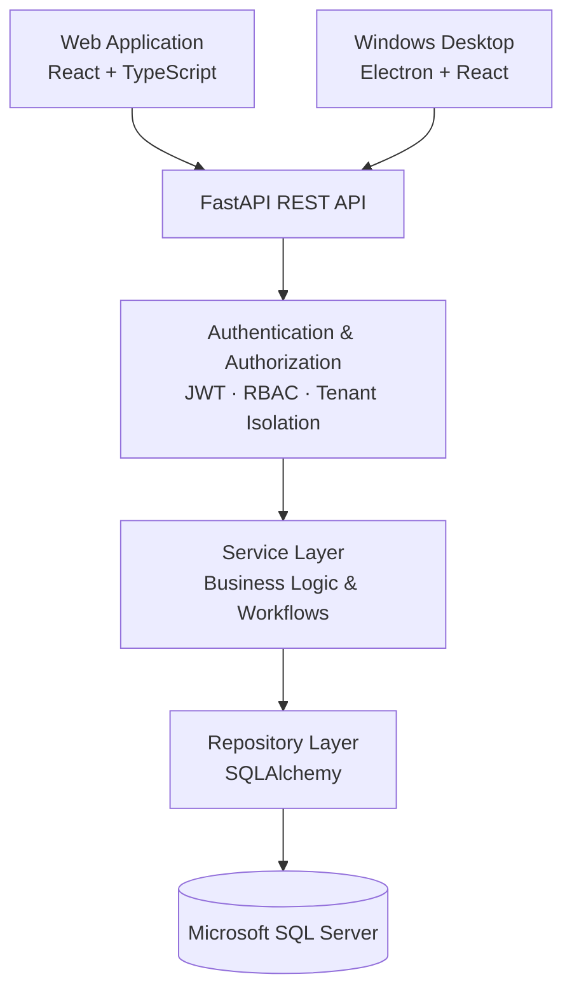
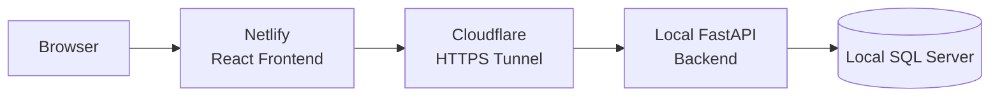

# ITOnIT

### One platform. Every IT request, asset, and team — connected.

**ITOnIT is a full-stack IT service management platform that brings ticketing, equipment inventory, and organizational administration together in one place.**

Built with React, TypeScript, FastAPI, and SQL Server, ITOnIT supports multiple organizations, role-based access, and both web and Windows desktop clients.

<p align="center">
  <a href="https://itonit.netlify.app"><strong>🌐 Explore the Live Application</strong></a>
</p>

<p align="center">
  
  
  
  
  
  
</p>

---

## The Idea Behind ITOnIT

IT support should be straightforward. An employee reports a problem, the right technician takes responsibility, and everyone involved knows what's happening.

In practice, it's rarely that simple.

Requests arrive through emails and messages, equipment records live in spreadsheets, and important updates get lost between conversations. As an organization grows, keeping track of everything becomes increasingly difficult.

**ITOnIT was built to bring those pieces together.**

Instead of treating support tickets, hardware inventory, and employee management as separate systems, ITOnIT connects them into a single workflow.

An employee can report an issue. A technician can manage the request, assign equipment, and document the resolution. An administrator can oversee the team's workload, manage users, and keep track of company resources.

And because the platform supports multiple organizations, each company can work within its own secure environment without needing a separate installation.

What began as a Computer Science final project became an opportunity to design and build an application that addresses a real operational problem.

---

## What Can ITOnIT Do?

###  IT Service Desk

A centralized place to manage IT requests from the moment they're submitted until they're resolved.

- Create, assign, prioritize, and manage support tickets.
- Track requests through their full lifecycle.
- Organize tickets by category, priority, and location.
- Assign tickets to technicians.
- Add comments and supporting attachments.
- Maintain a detailed history of ticket activity.
- Give employees visibility into the progress of their requests.

Every ticket has a clear status, an owner, and a record of what happened along the way.

###  Inventory & Equipment Management

ITOnIT doesn't stop at support tickets. It also helps teams manage the equipment involved in resolving them.

The system supports two inventory models:

| Serialized Assets | Bulk Inventory |
|---|---|
| Individually tracked equipment | Quantity-based stock |
| Laptops, monitors, and similar devices | Cables, mice, and other supplies |
| Unique asset identification | Stock quantity management |
| Individual equipment records | Reserve, consume, and release operations |

Inventory can be connected directly to tickets, making it possible to track equipment usage as part of the support process.

The platform also maintains inventory transaction history and supports low-stock and warranty-related monitoring.

###  Users, Roles & Permissions

Different people need different levels of access.

ITOnIT provides four distinct roles:

| Role | Responsibilities |
|---|---|
| **Employee** | Submit requests, follow their progress, and communicate with support |
| **Technician** | Handle assigned tickets, update statuses, and work with inventory |
| **Company Administrator** | Manage company users, settings, resources, and support operations |
| **System Administrator** | Manage the organizations registered on the platform |

Permissions are enforced by the backend, not just by hiding buttons in the interface.

This distinction is important: users can only perform actions their roles actually allow, even when accessing the API directly.

###  Multi-Organization Support

ITOnIT was designed to support more than one company.

Organizations can register through the public website and receive a unique company code. Their users, tickets, inventory, and settings belong to their own organizational environment.

The platform includes:

- Self-service company registration.
- Unique company identification codes.
- Organization-specific users and data.
- Company-level administration.
- A separate platform administration area.
- Company activation and suspension controls.

**One application can serve multiple organizations while keeping their data separated.**

###  Dashboards & Operational Visibility

ITOnIT turns everyday support activity into information that administrators and technicians can use.

Its dashboards provide visibility into ticket volumes, statuses, priorities, categories, historical trends, and inventory activity.

Dashboard content is adapted to the user's role, helping each person focus on the information relevant to their work.

###  Web & Windows Desktop

ITOnIT is available as a browser-based application and has an Electron-based Windows desktop client.

Both use the same React and TypeScript frontend and communicate with the same FastAPI backend.

This means the application can provide a consistent experience across clients without maintaining two separate frontend implementations.

---

## System Architecture

ITOnIT follows a layered client-server architecture.

The frontend is responsible for the user experience, while the backend handles authentication, permissions, business rules, and database operations.



### How a Request Moves Through the System

When a technician updates a ticket, the request passes through several layers:

1. The React application sends an authenticated API request.
2. FastAPI validates the request and identifies the user.
3. The authorization layer verifies the user's role and organization.
4. The service layer applies the relevant business rules.
5. The repository layer performs the database operations.
6. Ticket history is updated, and the result is returned to the frontend.

This separation makes the application easier to test, maintain, and extend.

Rather than putting database queries and business rules directly inside API endpoints, each layer has a defined responsibility.

---

## Technology Stack

| Area | Technologies |
|---|---|
| **Frontend** | React 19, TypeScript, Vite, React Router |
| **Desktop** | Electron, electron-builder |
| **Backend** | Python 3.12, FastAPI, Pydantic |
| **Database** | Microsoft SQL Server, SQLAlchemy |
| **Migrations** | Alembic |
| **Authentication** | JWT access and refresh tokens, Argon2 |
| **API Communication** | REST, Axios |
| **Testing** | pytest |
| **Code Quality** | Ruff, TypeScript strict mode, frontend linting |
| **Version Control** | Git, GitHub |
| **Web Deployment** | Netlify, Cloudflare Tunnel |

### Why This Stack?

**React and TypeScript** provide a reusable, component-based interface with compile-time type checking.

**FastAPI** offers a structured Python backend with request validation, dependency injection, and automatically generated API documentation.

**SQLAlchemy and SQL Server** support relational data modeling, database constraints, and the relationships required for tickets, users, inventory, and organizational data.

**Alembic** manages database schema changes through version-controlled migrations.

**Electron** allows the existing web interface to run as a Windows desktop application without rebuilding the entire frontend.

The goal was not simply to combine popular technologies, but to choose tools that work together in a maintainable architecture.

---

## Security & Data Isolation

Security is an important part of ITOnIT's design, especially because the platform serves multiple organizations.

### Authentication

ITOnIT uses JWT-based authentication with separate access and refresh tokens.

Passwords are stored using Argon2 hashing rather than plaintext.

### Role-Based Access Control

The backend validates permissions for protected operations. Frontend restrictions improve the user experience, but they are not treated as a security boundary.

### Organization Isolation

Organization-specific data access is handled through company-scoped repositories.

The organization context is derived from the authenticated user rather than trusted directly from client input.

This helps prevent users from accessing another company's tickets, equipment, or administrative records.

### Platform Administration

System Administrator access is separated from ordinary company administration.

The backend requires the appropriate role, administrator flag, and membership in the dedicated platform organization. Database-level constraints provide additional protection against duplicate platform administrators.

### Auditability

Ticket changes and inventory transactions are recorded so that important actions remain traceable.

**The guiding principle is simple: access should be explicit, organizational boundaries should be enforced, and important actions should leave a record.**

---

## Testing & Engineering Quality

ITOnIT includes an extensive backend test suite covering the application's main services, business rules, and permission boundaries.

The current repository contains **784 backend tests**. Running the full suite locally, **782 pass out of the box**; the remaining 2 are sensitive to local environment configuration rather than indicating application bugs — they assume the Help Center's `SUPPORT_EMAIL` setting is unset, which it intentionally isn't in an environment where that contact form is live. The underlying feature behaves correctly either way; this is a test-fixture detail being cleaned up, not a defect in the shipped code.

Testing covers areas such as:

- Authentication and token handling.
- User roles and authorization.
- Organization data isolation.
- Ticket creation and lifecycle operations.
- Comments and attachments.
- Inventory management and transactions.
- Company and platform administration.
- Business rules and error handling.

The backend uses dependency injection and test doubles to validate business logic without requiring every unit test to connect to a real database.

In addition to automated tests, the application has been exercised through end-to-end workflows using a separate rehearsal database.

This separation allows workflows to be tested without modifying the live demonstration data.

### Known Limitations

ITOnIT is a working academic project, not a claim of a fully production-hardened commercial service.

Some capabilities remain outside the current version, including multi-factor authentication, login rate limiting, server-side token revocation, and automatic desktop updates.

These limitations are documented as part of the project's technical debt and future development opportunities.

---

## Getting Started

### Prerequisites

To run ITOnIT locally, you will need:

- Python 3.12+
- Node.js 20+
- Microsoft SQL Server or SQL Server Express
- A compatible SQL Server ODBC driver
- Git

### 1. Clone the Repository

```bash
git clone https://github.com/emmahr1998/ITOnIT.git
cd ITOnIT
```

### 2. Configure the Backend

```bash
cd backend

python -m venv .venv
```

Activate the virtual environment.

**Windows:**

```powershell
.venv\Scripts\activate
```

**macOS / Linux:**

```bash
source .venv/bin/activate
```

Install the dependencies:

```bash
pip install -r requirements.txt -r requirements-dev.txt
```

Create a local `.env` file based on `.env.example`.

Configure the database connection and generate your own secure, random `SECRET_KEY`. Never use the example signing key in a public deployment.

Apply the database migrations:

```bash
python -m alembic upgrade head
```

Initialize the reference data:

```bash
python -m app.scripts.seed_initial_data
```

Start the API:

```bash
uvicorn app.main:app --reload
```

The backend will be available at:

- API: `http://127.0.0.1:8000`
- Swagger documentation: `http://127.0.0.1:8000/docs`

### 3. Start the Frontend

Open another terminal from the project root:

```bash
cd frontend
npm install
npm run dev
```

The frontend will be available at:

`http://localhost:5173`

By default, the frontend talks to `http://localhost:8000` (set via `VITE_API_BASE_URL` in `frontend/.env.development`). Change that value if your backend runs somewhere else.

### 4. Run the Tests

Backend:

```bash
cd backend
pytest
ruff check app tests scripts
```

Frontend:

```bash
cd frontend
npx tsc -b
npm run lint
npm run build
```

For more detailed setup and architecture information, see the documentation in the `docs/` directory.

---

## Windows Desktop Application

The desktop client is built with Electron and reuses the React frontend.

To build it from source:

```bash
cd frontend
npm install
npm run build:desktop
```

Then:

```bash
cd ../desktop
npm install
npm run dist
```

The desktop application connects to an external ITOnIT backend. It does not bundle its own SQL Server database or FastAPI service.

The current desktop build is unsigned and does not include automatic updates. A public installer download is not yet provided through GitHub Releases.

---

## Live Demo & Deployment

**Live application:** https://itonit.netlify.app

The public demonstration uses the following setup:



The frontend is hosted on Netlify, while the backend and database run on the development machine and are connected through a temporary Cloudflare Tunnel.

This setup makes it possible to demonstrate the complete application over the internet without maintaining a permanent cloud backend.

**Demo availability:** The backend must be running and connected for authenticated functionality to work. The public tunnel address may change when restarted.

This is the project's demonstration environment, rather than a permanent production hosting arrangement.

---

## Project Structure

```text
ITOnIT/
│
├── backend/
│   ├── app/
│   │   ├── api/             REST endpoints
│   │   ├── core/            Configuration and security
│   │   ├── models/          Database models
│   │   ├── schemas/         Request and response schemas
│   │   ├── repositories/    Database access
│   │   ├── services/        Business logic
│   │   └── dependencies/    Authentication and permissions
│   ├── alembic/             Database migrations
│   └── tests/               Automated backend tests
│
├── frontend/
│   └── src/                 React application
│
├── desktop/                 Electron application
│
└── docs/                    Technical documentation
```

---

## Documentation

Additional technical details are available in the repository:

| Document | Description |
|---|---|
| `docs/BACKEND_ARCHITECTURE.md` | Backend structure and design decisions |
| `docs/BACKEND_API_GUIDE.md` | API endpoints and usage |
| `docs/BACKEND_DIAGRAMS.md` | Architecture, database, and workflow diagrams |
| `docs/database-design.md` | Database design and relationships |
| `docs/TECH_DEBT.md` | Known limitations and technical improvements |
| `docs/PROFESSOR_DEMO_GUIDE.md` | Application demonstration walkthrough |
| `docs/PROFESSOR_QA.md` | Technical questions and project explanations |

---

## What I Learned Building ITOnIT

One of the biggest lessons from this project was that building a working application involves much more than connecting a frontend to a database.

The challenging parts were often the details between features: keeping permissions consistent, ensuring organizations cannot access one another's data, preserving history when records change, and making different parts of the system work together reliably.

ITOnIT also provided hands-on experience with database migrations, API design, authentication, automated testing, desktop packaging, and deploying a full-stack application for external access.

The result is a project that brings together the different areas of software engineering into one connected system.

---

## Project Background & Contributors

ITOnIT was developed as a **Computer Science final project**, covering the design and implementation of a full-stack IT management platform.

The project includes the application architecture, relational database, backend services, frontend interface, Windows desktop client, testing infrastructure, and public demonstration website.

**Contributors:**

- [emmahr1998](https://github.com/emmahr1998)
- [danielcohen0121](https://github.com/danielcohen0121)

---

<p align="center">
  <strong>ITOnIT</strong>
</p>

<p align="center">
  Making IT support easier to manage, one request at a time.
</p>

<p align="center">
  <a href="https://itonit.netlify.app">Explore ITOnIT</a> ·
  <a href="https://github.com/emmahr1998/ITOnIT">View Repository</a>
</p>
